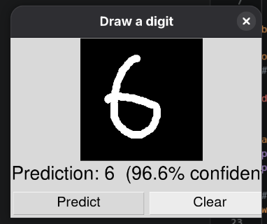
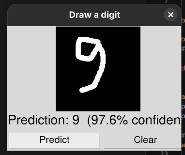

# Neural Network From Scratch: MNIST Digit Classifier

A two-layer neural network that recognizes handwritten digits, implemented using only **NumPy**. There are no deep learning frameworks and no autograd: the forward pass, backpropagation, the Adam optimizer, and the weight updates are all written by hand.

The project also includes a **Tkinter drawing app**: draw a digit with your mouse and watch the network predict it live, with a probability bar for each digit.

<p align="center">
  
  
</p>

## Highlights

- Fully manual implementation: forward pass, backpropagation, and Adam
- **~97.8% test accuracy** on MNIST with a single hidden layer
- Trains in about 15 seconds on a laptop CPU
- Backpropagation verified with a numerical gradient check
- Interactive drawing app with MNIST-style preprocessing and live predictions

## Architecture

```
Input (784) -> Dense (128) + ReLU -> Dense (10) + Softmax -> Output (10)
```

| Component | Choice | Reason |
|---|---|---|
| Initialization | He initialization, `std = sqrt(2 / fan_in)` | Suited to ReLU activations |
| Loss | Cross-entropy with a `1e-9` epsilon | Avoids `log(0)` on confident wrong predictions |
| Gradient | `dL/dz = probs - y_onehot` | Softmax + cross-entropy simplifies to this form |
| Optimizer | Adam (lr = 0.001, decayed by 0.9 per epoch) | Faster, smoother convergence than plain SGD |
| Batch size | 128 | Good use of matrix multiplication |
| Data type | float32 | Faster, and matches the dataset |
| Augmentation | Random shifts of up to 2 pixels | Makes the model more robust to off-center digits |
| Model selection | Best epoch by validation accuracy | Avoids saving a worse final epoch |

## Results

Trained for 15 epochs on the standard 50k / 10k / 10k train / validation / test split.

| Metric | Value |
|---|---|
| Test accuracy | ~97.8% |
| Training time | ~1 s per epoch on a CPU |

## Project Structure

| File | Description |
|---|---|
| `neural_network.py` | Scratchpad: a manual forward pass on tiny numbers, plus a numerical gradient check |
| `mnist_nueral_network.py` | Main pipeline: data loading, training with Adam, evaluation, and saving `model.npz` |
| `draw_predict.py` | Tkinter app: drawing canvas, MNIST-style preprocessing, live inference |
| `model.npz` | Trained weights (`W1`, `b1`, `W2`, `b2`) |
| `requirements.txt` | Python dependencies |
| `test1.png`, `test2.png` | Screenshots of the drawing app |

`mnist.pkl.gz` (the dataset) is not committed; see [Dataset](#dataset).

## Getting Started

### Prerequisites

- Python 3.8+
- NumPy
- Tkinter (bundled with most Python installs)
  - Fedora: `sudo dnf install python3-tkinter`
  - Ubuntu/Debian: `sudo apt install python3-tk`

### Installation

```bash
git clone https://github.com/Praneeth-Kakarla/Nueral-Network-Project-on-MNIST.git
cd Nueral-Network-Project-on-MNIST
python3 -m venv venv
source venv/bin/activate        # Windows: venv\Scripts\activate
pip install -r requirements.txt
```

### Dataset

Download `mnist.pkl.gz` (the 50k / 10k / 10k split) into the project folder:

```bash
curl -L -o mnist.pkl.gz https://github.com/mnielsen/neural-networks-and-deep-learning/raw/master/data/mnist.pkl.gz
```

### Train the model (optional)

A pre-trained `model.npz` is included. To retrain:

```bash
python3 mnist_nueral_network.py
```

Hyperparameters (hidden size, epochs, learning rate, augmentation) are constants at the top of the script.

### Run the drawing app

```bash
python3 draw_predict.py
```

Draw a digit on the canvas. The prediction updates when you release the mouse, and the bars on the right show the probability of each digit. Use **Clear** to start over.

### Verify backpropagation (optional)

```bash
python3 neural_network.py
```

This compares the analytic gradient with a numerical estimate and prints `gradient check PASSED` when they match.

## How the Drawing App Works

Feeding a raw 280x280 canvas, downscaled to 28x28, into the network gives poor results. MNIST digits are not plain downsampled images: they are cropped to the bounding box, scaled so the longer side is 20px, and centered in a 28x28 frame. The network has no built-in translation or scale invariance, so the app reproduces this preprocessing:

1. Crop the canvas to the drawn strokes
2. Resize to fit a 20x20 box, preserving the aspect ratio, using area averaging for soft MNIST-like edges
3. Place the result in a 28x28 frame
4. Shift the digit so its center of mass sits at the center of the frame
5. Flatten to 784 values and run the forward pass

## Roadmap

- [ ] Add a second hidden layer and compare against the baseline
- [ ] Add L2 regularization or dropout
- [ ] Add rotation and scaling to the data augmentation
- [ ] Implement a convolutional layer by hand

## License

Add a license of your choice (for example, MIT).
